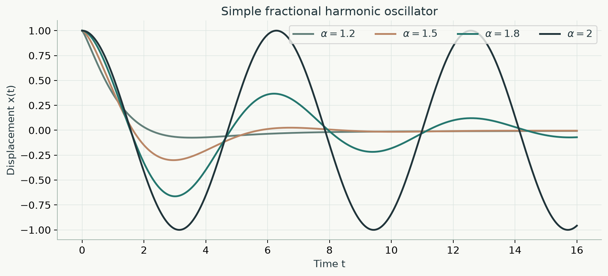

# Fractional Harmonic Oscillator

**Analysis and Computations · BSc Mathematics, Utrecht University (2025)**  
Kelvin Schouten · Supervisor: Paul Zegeling

This repository is a **remake of the code from my bachelor's thesis**. I have reorganized the original work and rewritten parts of the implementation to make the methods easier to understand, run and reproduce. The scripts used during the thesis are kept unchanged in [`archive/original_scripts/`](archive/original_scripts/); the revised code is in [`src/`](src/fractional_oscillator/).



## The model

The thesis studies how fractional derivatives change the behaviour of oscillating systems. The main example is the Caputo fractional oscillator:

$$
{}^C D_t^\alpha x(t)+\omega^2x(t)=0, \qquad 1<\alpha\leq2.
$$

Its solution is

$$
x(t)=x_0E_{\alpha,1}(-\omega^2t^\alpha)+v_0tE_{\alpha,2}(-\omega^2t^\alpha),
$$

where $x(0)=x_0$, $x'(0)=v_0$, and $E_{\alpha,\beta}$ is the Mittag-Leffler function. The classical harmonic oscillator is recovered at $\alpha=2$. For noninteger orders, the Caputo derivative depends on the past motion of the system.

## What is included

- **Analytical solutions:** Mittag-Leffler functions and the simple fractional oscillator.
- **Numerical methods:** L1 and quadratic Caputo approximations, plus a later Volterra-based reference solver.
- **Experiments:** Simple, nonlinear, damped and driven oscillators, with generated figures.
- **Original thesis scripts:** 38 Python files, preserved for reference.

## Run the code

Python 3.10 or newer:

```bash
python -m pip install -e ".[dev]"
python -m pytest -q
python examples/generate_figures.py
```

The last command recreates the figures in [`figures/`](figures/). The tests check selected mathematical identities and numerical cases.

## Project structure

```text
src/fractional_oscillator/   Rewritten functions and numerical solvers
examples/                    Figure generation
figures/                     Recreated plots (PNG and SVG)
tests/                       Automated tests
archive/original_scripts/    Original thesis code, unchanged
```

**Note.** This is a presentation and reproducibility remake, not the exact codebase as it existed in 2025. The recreated figures are based on the thesis models; they are not guaranteed to match every original plot. The numerical results are simulations, not measured data. No open-source license has been assigned.

[Research page](https://zorromir.github.io/#research)
